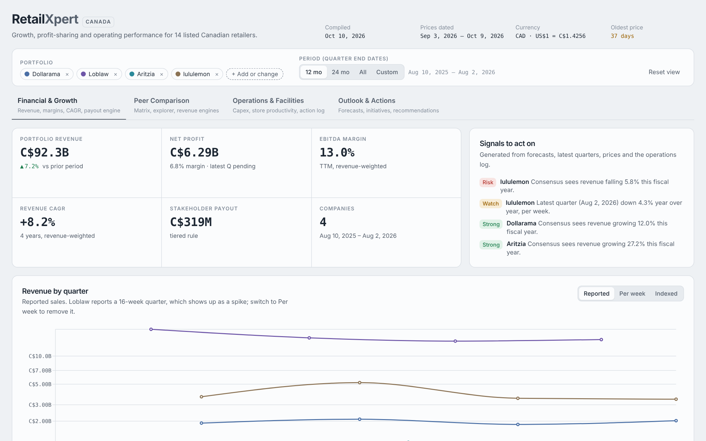
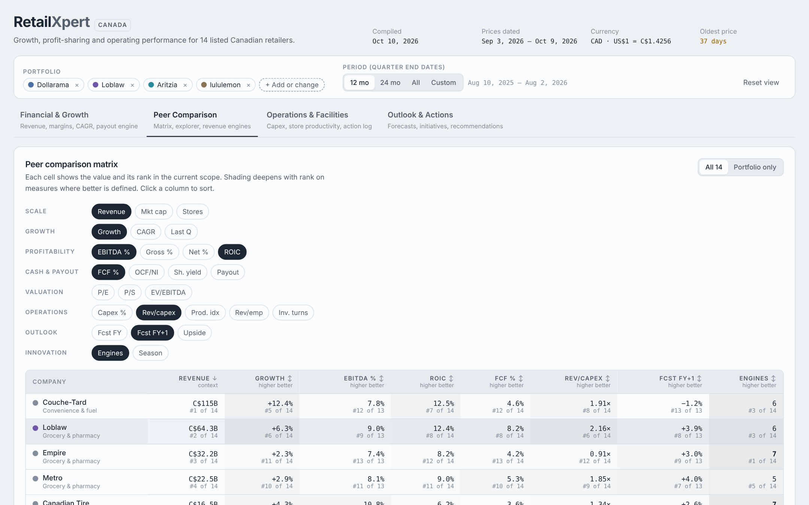
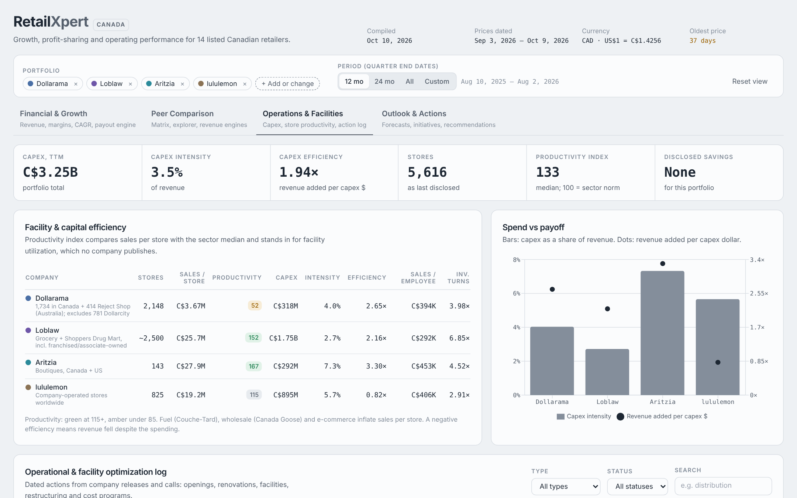
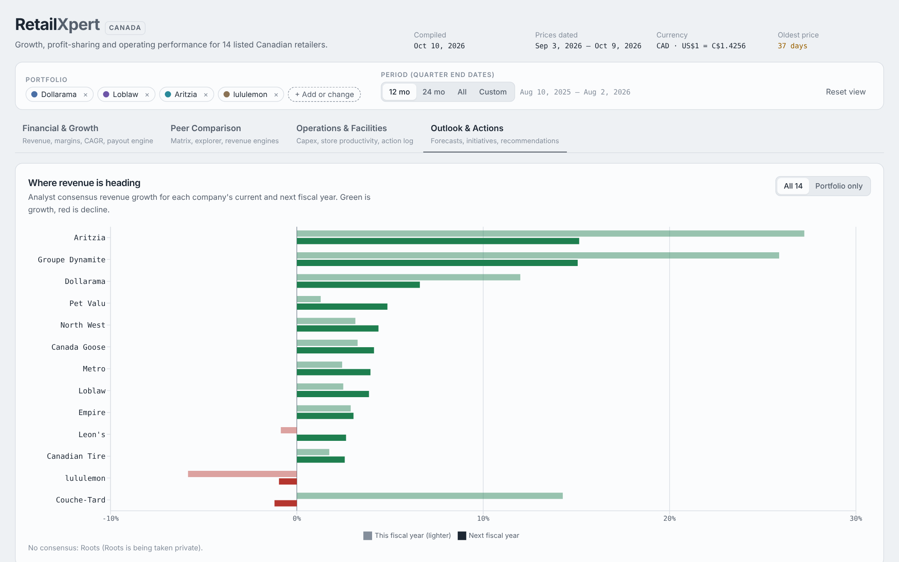
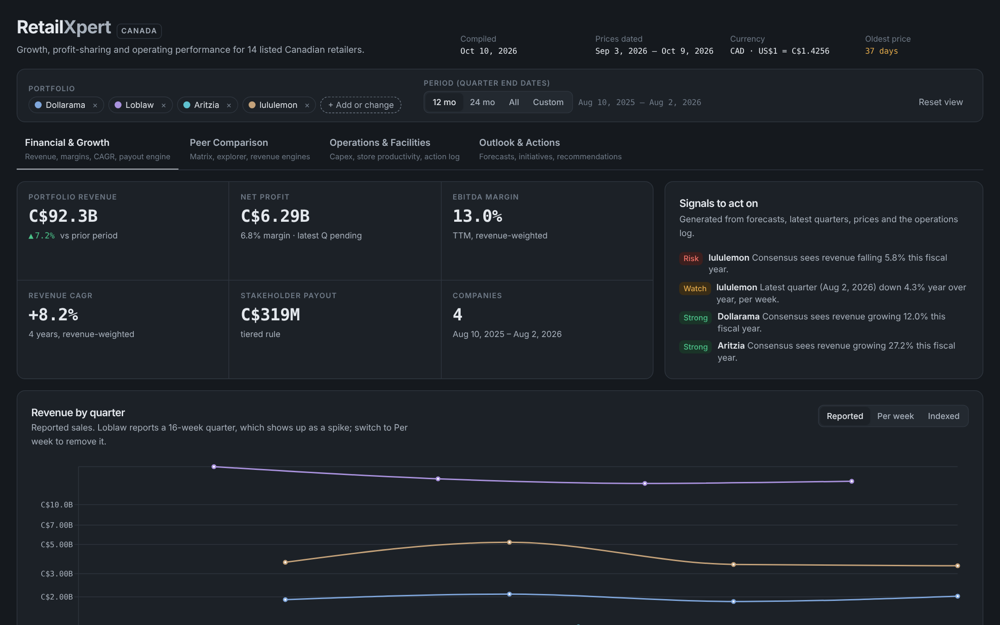

# RetailXpert

**Growth, profit-sharing and operating performance for 14 listed Canadian retailers, in one interactive dashboard.**

**Live demo:** https://shaunanthonylobo.github.io/retailxpert/



RetailXpert compares Loblaw, Couche-Tard, Empire (Sobeys), Metro, Canadian Tire, Dollarama, lululemon, Aritzia, Canada Goose, Pet Valu, Leon's, North West, Roots and Groupe Dynamite: together C$288B of trailing twelve-month revenue. Every figure is sourced and dated.

## What's inside

| Tab | What it answers |
|---|---|
| **Financial & Growth** | How fast is the portfolio growing, how profitable is it, and what would a stakeholder profit-share pay? Summary KPIs, automatic risk signals, quarterly revenue, growth table, and a tiered payout engine you can tune live. |
| **Peer Comparison** | Who leads on what? A 14-company matrix across 27 ranked measures, an explorer that plots any measure against any other, and a map of 14 revenue engines beyond the till (loyalty, financial services, retail media, franchising, international, health…). |
| **Operations & Facilities** | Is capital being spent well? Capex intensity and efficiency, store productivity vs sector, disclosed cost savings, and a filterable log of 48 dated operational actions. |
| **Outlook & Actions** | Where is revenue heading? Analyst consensus for this year and next, what each company is working on now, and 41 recommended actions. |

| | |
|---|---|
|  |  |
|  |  |

## Details most dashboards miss

- **One time window.** Fiscal years end in six different months, so every ratio uses trailing twelve months.
- **One currency.** Couche-Tard and lululemon report in US dollars; figures are converted at a dated USD/CAD rate.
- **Fair quarters.** Grocers report 12- and 16-week quarters; a per-week view stops a 16-week quarter looking like a sales spike.
- **Honest blanks.** A P/E on near-zero profit or a conflicting EBITDA figure shows as a dash, not a misleading number.
- **Dated prices.** Every share price carries its quote date, and stale prices raise a warning.
- **Labelled estimates.** Facility utilization isn't published, so the store productivity index (sales per store vs sector median) is labelled as a proxy.

## Built with

React 18 · TypeScript (strict) · Tailwind CSS · Recharts · Python data pipeline · esbuild · GitHub Actions + Pages

The build produces a single self-contained 675 KB HTML file: no server, no database.

## Run it locally

Needs Node.js 18+ and Python 3.8+.

```bash
npm install
npm run build      # Python pipeline → Tailwind → esbuild → dist/index.html
npm run preview    # http://localhost:5173
```

## Project structure

| Path | Role |
|---|---|
| `data/retailers_data.py`, `data/retailers_extra.py` | Sourced facts: results, quarters, cash flow, forecasts, initiatives |
| `scripts/build_data.py` | Converts to CAD, computes quarter lengths, writes typed JSON |
| `src/lib/finance.ts` | CAGR, margins, tiered profit-share engine, capex efficiency, productivity index |
| `src/lib/metrics.ts` | The 27 comparison measures and ranking |
| `src/lib/format.ts` | Humanized numbers (C$1.23M, C$450K) |
| `src/state/store.tsx` | Reducer for portfolio, date range, payout rule and filters |
| `src/components/` | The four tabs and shared UI |
| `.github/workflows/deploy.yml` | Type-checks, builds and deploys on every push |

## Data and sources

Financial statements, cash flow and analyst consensus: StockAnalysis (S&P Global Market Intelligence). Store counts, initiatives and operational actions: company releases and earnings calls, linked inside the dashboard. Data compiled October 10, 2026. To refresh, edit `data/` and run `npm run build`.

Recommendations are analysis of published figures, not company plans. **Not investment advice.**


